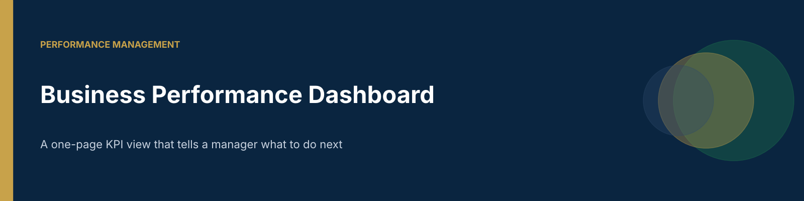
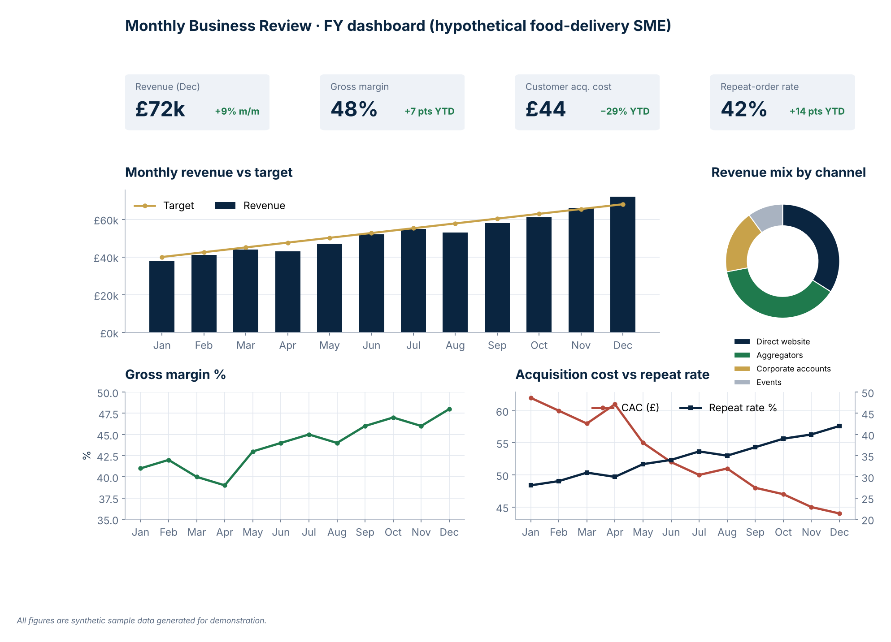

# Business Performance Dashboard

**A one-page monthly business review that tells a manager what happened, why, and what to do next.** Built in Excel so any SME can use it without new software.

> **Data note.** All figures are **synthetic** and describe a hypothetical food-delivery SME. Replace the yellow cells with your own monthly numbers.

---

## 1. The business problem

Small businesses usually have plenty of data (sales exports, ad dashboards, accounting software) but no single view of performance. Monthly reviews turn into debates about whose number is right, and the meeting ends without decisions.

## 2. Objectives

1. Agree a **small set of KPIs** with fixed definitions.
2. Show them on **one page**: trend, target and direction.
3. Pair every number with **commentary that leads to an action**.

## 3. KPI design

| KPI | Definition | Why it matters |
|---|---|---|
| Revenue vs target | Revenue ÷ target − 1 | Are we on plan? |
| Gross margin % | (Revenue − cost of sales) ÷ revenue | Pricing power and cost control in one number |
| Customer acquisition cost | Marketing spend ÷ new customers | What growth costs |
| Average order value | Revenue ÷ orders | Bundling and pricing effectiveness |
| Repeat rate % | Repeat orders ÷ total orders | Retention, the cheapest source of revenue |

## 4. The dashboard

## 5. Monthly commentary (example, December)

| What happened | Why | So what / action |
|---|---|---|
| Revenue £72k, +9% m/m, above target for the second month running | Seasonal demand plus corporate accounts growing to 18% of mix | Lock in Q1 corporate renewals now, before seasonal demand drops |
| Gross margin up to 48% (+7 pts on the year) | Menu re-pricing in May; fewer discounted aggregator promotions | Keep promotions to direct channel, where margin is higher |
| CAC down 29% to £44 | More repeat and referral orders; less paid acquisition | Shift 10% of paid budget to a referral incentive and measure for 60 days |
| Revenue below target in 10 of 12 months | Target was set on an optimistic H1 assumption | Re-base FY targets on the H2 run-rate; review quarterly, not annually |

**The discipline:** every row ends with an owner and a date. A dashboard that does not change a decision is decoration.

## 6. Deliverables

| File | Contents |
|---|---|
| [`templates/performance-dashboard.xlsx`](templates/performance-dashboard.xlsx) | **Dashboard** (KPI tiles and native Excel charts) · **Monthly data** (inputs plus calculated KPIs with on/off-target highlighting) · **KPI definitions** |

## 7. How to use

1. Paste your monthly figures into the yellow columns on **Monthly data**.
2. The KPI columns, highlights, tiles and charts update automatically.
3. Before the review meeting, write the three-column commentary: *what happened, why, so what*.
4. Keep KPI definitions fixed for the year so trends stay comparable.

---

Prepared by <a href="https://github.com/sohaibshabbir9-del">Sohaib Shabbir</a> · Performance management & reporting · Synthetic data for portfolio purposes.
